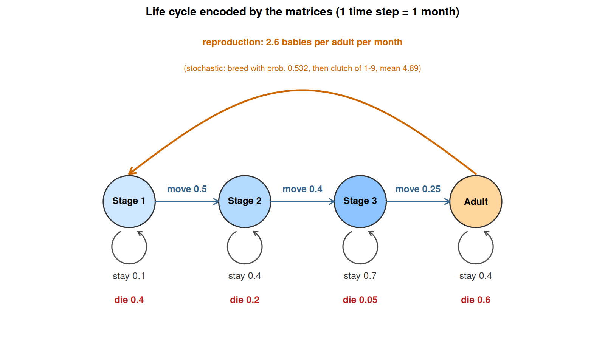
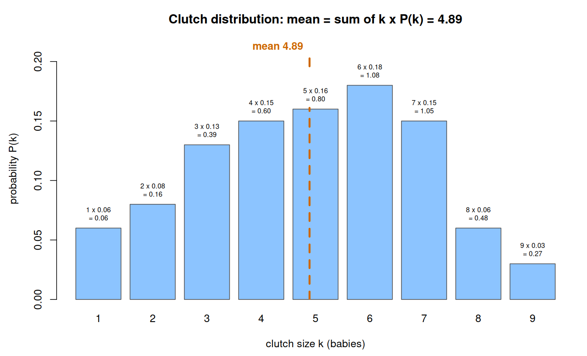
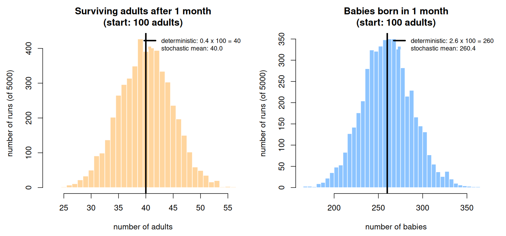
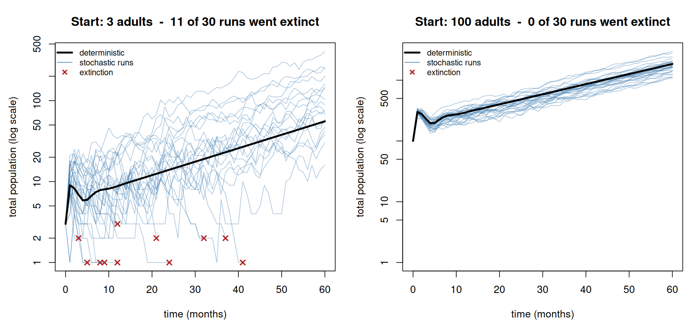

# Part 1 – How the demographic model works

Companion to `code/Demographic.R` and `code/demographic_parameters.R`. Background theory (projection matrices, eigenvalues) is in [Populations.md](Populations.md).

> Parameter values come from the 2024 HPC worksheet in the MQB repo (`content/hpc/instructions/2024_11_16_HPC_worksheet.ipynb`). To confirm with the lecturer that they are the 2026 defaults.
>
> There are **no worked answers** in MQB: only the questions, an empty pro forma (`abc123_hpc_2024_main.R`), the provided `demographic.R` and a general mark scheme. The 2024 task also differs from 2026 (different job counts, initial states and figure spec).

---

## 1. Reading the matrices

- **Columns = "from"** (current stage), **rows = "to"** (next stage).
- Entry `[j, i]` = contribution of ONE stage-*i* individual to stage *j* next month.
- In R, `matrix(..., byrow = TRUE)` fills **row by row**, so the first line typed is row 1 = "to stage 1".



*Every number in the matrices is one arrow in this picture. Blue arrows and loops = growth matrix (probabilities); orange arrow = reproduction matrix (a rate); "die" = 1 − column sum (not stored in the matrix).*

### Growth matrix (survival / maturation probabilities)

```
            from: st1   st2   st3   st4
  to st1          0.1   0.0   0.0   0.0
  to st2          0.5   0.4   0.0   0.0
  to st3          0.0   0.4   0.7   0.0
  to st4          0.0   0.0   0.25  0.4
```

| Stage | Stay | Move on | Die (= 1 − column sum) | Column sum |
|---|---|---|---|---|
| 1 | 0.1 | 0.5 → stage 2 | 0.4 | 0.60 |
| 2 | 0.4 | 0.4 → stage 3 | 0.2 | 0.80 |
| 3 | 0.7 | 0.25 → stage 4 | 0.05 | 0.95 |
| 4 (adults) | 0.4 | – | 0.6 | 0.40 |

Death is **not stored** in the matrix, so columns sum to **≤ 1**, not exactly 1. A column summing to 1 would mean that stage never dies.

### Reproduction matrix

Only entry `[1, 4]` = **2.6**: each adult produces on average 2.6 stage-1 offspring per month. It is a **rate**, not a probability, so it can be > 1.

### Projection matrix (deterministic model only)

$$P = \text{growth} + \text{reproduction} = \begin{pmatrix} 0.1 & 0 & 0 & 2.6 \\ 0.5 & 0.4 & 0 & 0 \\ 0 & 0.4 & 0.7 & 0 \\ 0 & 0 & 0.25 & 0.4 \end{pmatrix}$$

- Adult column = (2.6, 0, 0, 0.4): one adult → 2.6 offspring + 0.4 of itself = 3.0 individuals next month.
- Dominant eigenvalue λ ≈ **1.039** → long-run growth ≈ 3.9 % per month, so the deterministic population never goes extinct.

---

## 2. Where 4.89 comes from

`clutch_distribution` = probability that a reproducing adult has a clutch of size *k*:

| Clutch size *k* | 1 | 2 | 3 | 4 | 5 | 6 | 7 | 8 | 9 |
|---|---|---|---|---|---|---|---|---|---|
| P(*k*) | 0.06 | 0.08 | 0.13 | 0.15 | 0.16 | 0.18 | 0.15 | 0.06 | 0.03 |
| *k* × P(*k*) | 0.06 | 0.16 | 0.39 | 0.60 | 0.80 | 1.08 | 1.05 | 0.48 | 0.27 |

**Mean (expected value)** of a discrete distribution = Σ value × probability:

$$E[\text{clutch}] = \sum_k k\,P(k) = 0.06 + 0.16 + 0.39 + 0.60 + 0.80 + 1.08 + 1.05 + 0.48 + 0.27 = 4.89$$

A weighted average: common clutches (5–7) pull it to the middle; 1 and 9 are rare.



*Each bar's label is its contribution k × P(k); the nine contributions add up to 4.89, the "balance point" of the bars.*

In code (`stochastic_recruitment()`):

```r
expected_clutch_size <- sum(clutch_distribution * (1:length(clutch_distribution)))
#                           (0.06, 0.08, ...)   *   (1, 2, ..., 9)  → summed = 4.89
```

### Where the 53 % breeding chance comes from (2.6 ÷ 4.89)

It is **not a separate measured parameter**. It is *calculated* from two numbers we already have, so that the stochastic model matches the deterministic one.

**The two ingredients**
1. **2.6** (reproduction matrix): on average one adult produces 2.6 babies per month.
2. **4.89** (clutch distribution): when an adult breeds, it has 4.89 babies on average.

**The problem.** In the stochastic model an adult can't have 2.6 babies. Babies come in whole clutches (1–9, average 4.89). If every adult bred every month, each would average **4.89** babies, nearly double the intended 2.6.

**The fix.** Each adult breeds only in *some* months. We need the fraction of months that gives an average of 2.6:

$$\text{chance of breeding} \times \text{average clutch} = 2.6$$
$$p \times 4.89 = 2.6 \quad\Rightarrow\quad p = \frac{2.6}{4.89} = 0.532 \approx 53\,\%$$

**Check with 100 adults**
- about 53 breed (53 %)
- each has ~4.89 babies on average
- total ≈ 53 × 4.89 ≈ **260** babies = 2.6 per adult, the same as the deterministic model ✔

**In the code** (`stochastic_recruitment()` in `code/Demographic.R`):

```r
recruitment_rate <- reproduction_matrix[1, 4]                      # 2.6
expected_clutch_size <- sum(clutch_distribution * (1:9))           # 4.89
recruitment_probability <- recruitment_rate / expected_clutch_size # 0.532
```

Change 2.6 or the clutch distribution and the 53 % updates automatically. It only works if 2.6 ≤ 4.89; otherwise *p* > 1 and the code stops with an error.

---

## 3. Deterministic model: worked example

$n_{t+1} = P\,n_t$. Each new entry = row of *P* × state vector, summed.

**Month 0 → 1**, from $n_0 = (0, 0, 0, 100)$:

| Stage | Calculation | Result |
|---|---|---|
| 1 | 0.1·0 + 0·0 + 0·0 + **2.6·100** | **260** (offspring) |
| 2 | 0.5·0 + 0.4·0 + 0 + 0 | 0 |
| 3 | 0 + 0.4·0 + 0.7·0 + 0 | 0 |
| 4 | 0 + 0 + 0.25·0 + **0.4·100** | **40** (surviving adults) |

Total = **300** (checked in `test_demographic.R`).

**Month 1 → 2**, from (260, 0, 0, 40):

| Stage | Calculation | Result |
|---|---|---|
| 1 | 0.1·260 (stayed) + 2.6·40 (new offspring) = 26 + 104 | 130 |
| 2 | 0.5·260 (matured) | 130 |
| 3 | 0.4·0 + 0.7·0 | 0 |
| 4 | 0.25·0 + 0.4·40 | 16 |

Total = **276**: the total **drops** at first, because there are few adults while offspring are still maturing. After many months the stage mix settles (stable stage distribution = dominant eigenvector) and the total grows ×1.039 per month. Same "transient then stable" pattern as the salmon example in [Populations.md](Populations.md).

---

## 4. Stochastic model: individuals rolling dice

### The core idea
- **Deterministic:** works with *fractions*. "40 % of adults survive", so 100 adults → 40, and 3 adults → 1.2 adults.
- **Stochastic:** works with *individuals*. Each animal gets its own random fate, like rolling its own weighted die. You can't have 1.2 adults, only 0, 1, 2 or 3.

That's all "stochastic" means here: **every probability in the matrices becomes a dice roll for each individual.**

### One month = three steps

| Step | Question each individual asks | Dice | Code |
|---|---|---|---|
| 1. Survival & maturation | "Do I stay, move up a stage, or die?" | that stage's column of the growth matrix | `survival_maturation()` → `multinomial()` |
| 2. Reproduction | (adults only) "Do I breed? If so, how many babies?" | coin with 53 % heads, then the clutch die (1–9) | `offspring_calc()` → `random_draw()` |
| 3. Add babies | the babies go into stage 1 | – | `stochastic_step()` |

### Worked example: start with 3 adults
This is **one possible** run; the rolls are made up but realistic.

#### Month 1: state = (0, 0, 0, **3**)

**Step 1, survival.** Each adult rolls: 40 % survive, 60 % die.
- Adult A survives, B dies, C dies → **1 adult left**.

**Step 2, reproduction.** All three adults count, because breeding uses the adults at the **start** of the month (this matches the deterministic $P\,n_t$).
- A flips the 53 % coin: heads, breeds. Clutch die → **6** babies.
- B: heads, breeds → **4** babies.
- C: tails, no babies.
- Total = **10** babies.

**Step 3.** Babies go into stage 1 → new state = (**10**, 0, 0, **1**).

Deterministic model from the same start: (7.8, 0, 0, 1.2).

#### Month 2: state = (10, 0, 0, 1)

**Step 1, survival.** Now there are stage-1 individuals, with **three** possible fates. Read column 1 of the growth matrix:

```
column 1 = (0.1, 0.5, 0, 0)  →  10 % stay in stage 1, 50 % move to stage 2, 40 % die
```

- Each of the 10 rolls this three-way die, e.g. 1 stays, 5 move up, 4 die.
- **This is what `multinomial()` does:** it rolls the same die for everyone in a stage at once and counts how many landed on each outcome.
- The lone adult rolls its 40 % survival die: it dies.

After step 1: (1, 5, 0, 0).

**Step 2, reproduction.** One adult was alive at the start of the month. It flips the coin: heads, and rolls a clutch of **3**.

**Step 3.** New state = (1 + 3, 5, 0, 0) = (**4, 5, 0, 0**).

#### What just happened
There are **no adults left**. The population survives only if some juveniles get through stages 2 and 3 (which takes months, with deaths along the way) and become adults before they all die. **This is how extinction happens in the stochastic model.** The deterministic model never has this problem: it always keeps a fraction of an adult that keeps breeding.

With **100** adults the same dice are rolled hundreds of times. Lucky and unlucky rolls cancel out, so the result lands close to the deterministic numbers. For example, one month from (0, 0, 0, 100) gives about (260, 0, 0, 40): ~53 breeders × 4.89 ≈ 260 babies, and ~40 survivors (could be 33 or 47).



*How to read this: it is NOT 5000 animals. The same one-month experiment (start with 100 adults, every animal rolls its dice once) was **repeated 5000 times from scratch**, like 5000 parallel universes. Each universe gives one result (e.g. "38 adults survived, 247 babies"). The x-axis is that result; bar height = how many of the 5000 universes got it. Results vary (adults ~25–55, babies ~170–360), but the **average** lands exactly on the deterministic value (black line). This is what "the deterministic model is the average of the stochastic model" means. Panel b uses the same idea: repeat many simulations and count the fraction that go extinct.*

### The trickiest bit of the code
In `survival_maturation()`, for each stage `i`:

```r
transition_probs <- growth_matrix[, i]                        # e.g. stage 1: (0.1, 0.5, 0, 0)
individuals_count <- multinomial(state[i], transition_probs)  # e.g. (1, 5, 0, 0)
new_state <- new_state + individuals_count
```

The output of `multinomial()` is already laid out like a state vector: "how many go to stage 1, 2, 3, 4", with the dead dropped. It works because the column entries *are* the "to stage 1, 2, 3, 4" probabilities (columns = from, rows = to). Doing this for every stage and adding the results gives everyone's new position.

### Try it yourself
Run this from the project root and re-run the `stochastic_step` lines a few times. Each run gives a different path, and some reach 0:

```r
source("code/Demographic.R"); source("code/demographic_parameters.R")
p <- stochastic_recruitment(reproduction_matrix, clutch_distribution)   # 0.532
s <- c(0, 0, 0, 3)
s <- stochastic_step(s, growth_matrix, reproduction_matrix, clutch_distribution, p); s
s <- stochastic_step(s, growth_matrix, reproduction_matrix, clutch_distribution, p); s
```

### Summary: deterministic vs stochastic

| | Deterministic | Stochastic |
|---|---|---|
| Matrix used | projection (growth + reproduction) | growth and reproduction separately |
| Survival | fraction (0.4 × 100 = 40) | multinomial/binomial draw per stage |
| Reproduction | 2.6 × adults | Binomial(adults, 0.532) breeders × random clutch sizes |
| Numbers | can be fractional | always whole |
| Extinction | impossible here (λ > 1) | possible by chance |
| Mean behaviour | – | equals the deterministic model |

---

## 5. Why this matters for the figure (panel b)



*30 stochastic runs (blue) and the deterministic model (black) over 60 months, log scale. Left: from 3 adults the runs spread widely and 11/30 went extinct (red ×), mostly in the first year. Right: from 100 adults the runs stay close to the black line and none went extinct. Note the early dip in both: adults die before their babies mature.*

> This is a study figure, not the coursework panel a (which needs 100 vs 10 adults, 24 steps, deterministic solid vs stochastic dashed; check the brief). Figures are made by `notes/images/make_part1_figures.R` (run from the project root).

- With 100 adults, the random draws average out → stochastic runs stay close to the deterministic line.
- With 3 adults, chance dominates. All 3 adults die in month 1 with probability 0.6³ ≈ **22 %**, and offspring still need several months to mature (and have high mortality on the way). The deterministic model instead keeps 1.2 "adults" and carries on.
- That gap is **demographic stochasticity**: extinction probability should fall as initial size increases (3 > 10 > 30 > 100).
