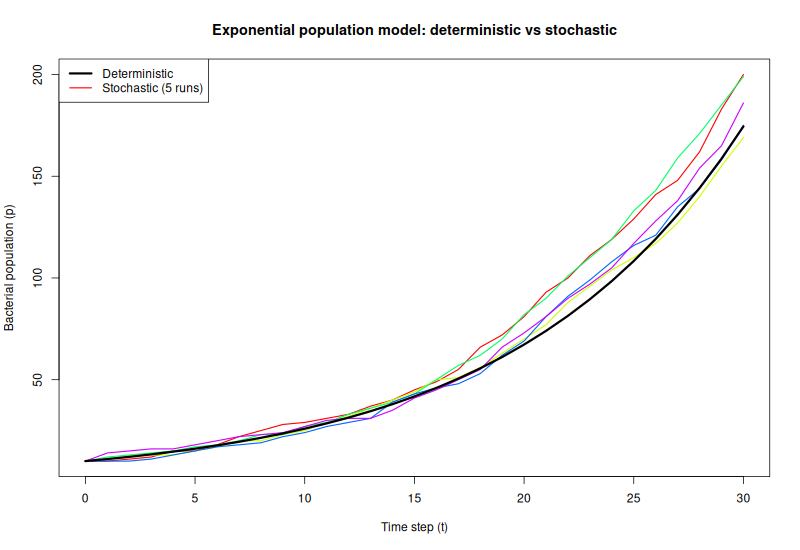

# Lecture 2 – Populations (first part)
*James Rosindell*

## Lecture outline
1. Population modelling overview and stochastic vs deterministic
2. Demographic population models and matrix population models
3. Stochastic adaptation

---

# 1. Population modelling overview

## What is a population model?
- Models how a population (or population**s**) changes over time
- We might be interested in...
    - The effect of different parameters on the population dynamics
    - Identifying an appropriate control or conservation strategy
    - The likelihood of extinction or recovery
- We can make different assumptions:
    - **Homogeneous** – every individual is the same
    - **Heterogeneous** – individuals can be different
        1. **Compartmental** – there are different compartments and every individual in the same compartment is the same
        2. **Individual-based** – we explicitly model every single individual and all their traits

## Stochastic vs deterministic modelling
- **Deterministic = determined**
    - Assumes that outcomes follow determined paths
    - Can be simulated once to observe modelled behaviour
- **Stochastic = random**
    - Assumes that outcomes are drawn from random distributions
    - Must be simulated many times to observe modelled behaviour, since every simulation can be different
    - Typically closer to reality as life is inherently random!

## Example: Exponential population model
- **Deterministic** (black line): every time step, the bacterial population multiplies by 1.1
    - $p_{t+1} = 1.1\,p_t$
- **Stochastic** (coloured lines): every time step, there is a 10% chance of each individual bacterium reproducing
    - $p_{t+1} = p_t + N_{t+1}$
    - $N_{t+1} \sim \text{Bin}(p_t,\ 0.1)$

```r
# Deterministic model: p[t+1] = 1.1 * p[t]
deterministic <- function(p0, t_max) {
  p <- numeric(t_max + 1)
  p[1] <- p0
  for (t in 1:t_max) {
    p[t + 1] <- 1.1 * p[t]
  }
  p
}

# Stochastic model: p[t+1] = p[t] + N[t+1], where N[t+1] ~ Bin(p[t], 0.1)
stochastic <- function(p0, t_max) {
  p <- numeric(t_max + 1)
  p[1] <- p0
  for (t in 1:t_max) {
    births <- rbinom(1, p[t], 0.1)
    p[t + 1] <- p[t] + births
  }
  p
}

set.seed(1)
p0 <- 10
t_max <- 30
time <- 0:t_max

det <- deterministic(p0, t_max)
sims <- replicate(5, stochastic(p0, t_max))   # 5 stochastic runs

png("images/exponential_model.png", width = 800, height = 550)
matplot(time, sims, type = "l", lty = 1, lwd = 1.5, col = rainbow(5),
        ylim = range(c(sims, det)),
        xlab = "Time step (t)", ylab = "Bacterial population (p)",
        main = "Exponential population model: deterministic vs stochastic")
lines(time, det, col = "black", lwd = 3)
legend("topleft", legend = c("Deterministic", "Stochastic (5 runs)"),
       col = c("black", "red"), lwd = c(3, 1.5))
dev.off()

cat("Deterministic p at t = 30:", round(det[t_max + 1], 1), "\n")
cat("Stochastic p at t = 30:", sims[t_max + 1, ], "\n")
```

**Output:**
```
Deterministic p at t = 30: 174.5 
Stochastic p at t = 30: 200 169 199 175 186
```



### Lecture output table (p₀ = 10, 7 stochastic runs)
| model_type | sim | t0 | t1 | t2 | t3 | t4 | t5 | t6 | t7 | t8 | t9 |
|---|---|---|---|---|---|---|---|---|---|---|---|
| deterministic | NA | 10 | 11 | 12.1 | 13.31 | 14.64 | 16.11 | 17.72 | 19.49 | 21.44 | 23.58 |
| stochastic | 1 | 10 | 12 | 13 | 14 | 17 | 19 | 20 | 22 | 24 | 26 |
| stochastic | 2 | 10 | 11 | 11 | 14 | 15 | 15 | 16 | 20 | 24 | 29 |
| stochastic | 3 | 10 | 11 | 12 | 15 | 16 | 19 | 20 | 22 | 25 | 27 |
| stochastic | 4 | 10 | 11 | 13 | 14 | 16 | 19 | 20 | 22 | 24 | 26 |
| stochastic | 5 | 10 | 11 | 13 | 13 | 15 | 17 | 18 | 19 | 20 | 22 |
| stochastic | 6 | 10 | 11 | 12 | 12 | 12 | 12 | 12 | 12 | 12 | 14 |
| stochastic | 7 | 10 | 10 | 11 | 12 | 13 | 14 | 16 | 18 | 18 | 19 |

- The deterministic simulation is based on **averages** → gives **continuous**, not discrete, outputs
    - If we were modelling number of bacteria, this is biologically unrealistic (you can't have 16.11 bacteria)
- In this particular situation, the deterministic simulation reflects the **average behaviour** of the stochastic model

### When do the two agree?
- **Good approximation:** in some situations deterministic and stochastic models give very similar outcomes
    - e.g. with initial population **1000** instead of 10, all stochastic runs hug the deterministic line (≈1000 → ≈2300 over 10 steps). Large populations → randomness averages out
- **Average behaviour:** the deterministic model can match the *mean* of many stochastic runs
    - e.g. averaging the 7 stochastic runs (p₀ = 10) at each time point gives a line almost on top of the deterministic one

## Stochastic modelling – why bother?
- Enables us to include realistic probability distributions (rather than assuming everything follows the "average" outcome)
- Can handle **discrete outcomes**
    - e.g. whole numbers of organisms; not 16.11 bacteria
- Most important in situations where:
    - Stochastic events can make a substantial difference
    - Future changes are sensitive to the current value
    - We want some certainty bounds around our results
- Should be **run many times** to get an overall sense of model behaviour → this is where **cluster computing** is useful
- Trade-off: **biological realism vs computational effort**

---

# 2. Demographic & matrix population models

## Demographic population models
- Describe how a population changes in terms of, and in response to, a **demographic structure** in the population
- The demographic structure is typically a set of traits which affect **life history processes** (i.e. birth and death)
- A simple demographic trait to structure a model is **age**
- Other traits: body weight, sex, sexual maturity
- Can also incorporate evolutionary processes ("**evolutionary demography**") → used to explore evolution of life history "strategies"

## Matrix population models
- Usually means an **age-** or **stage-structured matrix population model**
- The population is divided into **discrete life stages** or **age classes**
- Each **stage/class has a set of parameters** describing **demographic processes** (survival, maturation, recruitment)
- The population is represented by a **state vector**: the number of individuals in each stage/class
- The parameters go into a **projection matrix**, which is applied to the state vector to project the population forwards in time
- Matrix population models are typically **deterministic**

*(Slide aside: xkcd comic of "the right response to the wrong emergency" – a grid of situations × responses where only the diagonal works. A way to picture a matrix: rows × columns, each cell = one combination.)*

## Matrix multiplication refresher
- To get entry (row *i*, column *j*) of **A·B**: take row *i* of A, column *j* of B, multiply pairwise and sum

$$
\begin{pmatrix} a_{11} & a_{12} & a_{13} \\ a_{21} & a_{22} & a_{23} \\ a_{31} & a_{32} & a_{33} \end{pmatrix}
\begin{pmatrix} b_{11} & b_{12} \\ b_{21} & b_{22} \\ b_{31} & b_{32} \end{pmatrix}
$$

- e.g. entry (2,2) $= a_{21}b_{12} + a_{22}b_{22} + a_{23}b_{32}$
- Matrix × vector works the same way (a vector is a 1-column matrix): entry 2 $= a_{21}b_{11} + a_{22}b_{21} + a_{23}b_{31}$
- (3×3)·(3×2) → 3×2; (3×3)·(3×1) → 3×1. Inner dimensions must match.
- In R: `A %*% B` (not `A * B`, which is element-wise)

## Example: coursework as a matrix model
- **Columns = current state**, **rows = next state**. Each cell = probability of moving from the column's state to the row's state in one time step

| Next ↓ \ Current → | Assigned | Started | Finished |
|---|---|---|---|
| **Assigned** | 0.2 (laziness or too busy) | 0.1 (data loss disaster without a backup) | 0 (impossible) |
| **Started** | 0.8 (do work) | 0.5 (keep working but not done yet) | 0 (impossible) |
| **Finished** | 0 (cheating) | 0.4 (do work) | 1 (celebrate! it's all done) |

- Each column sums to 1 (everyone has to end up somewhere)
- Current state vector: 40 assigned, 10 started, 10 finished
- Next state:
    - Assigned: 0.2·40 + 0.1·10 + 0·10 = 8 + 1 = **9**
    - Started: 0.8·40 + 0.5·10 + 0·10 = 32 + 5 = **37**
    - Finished: 0·40 + 0.4·10 + 1·10 = 4 + 10 = **14**

## Atlantic salmon life cycle
- **River:** Egg → Alevin → Parr → Smolt (1–7 years in the river)
- **Sea:** Smolt → Adult (1–2 years at sea) → adults return to the river to spawn eggs

## Atlantic salmon toy matrix population model
- 3 stages: eggs, juveniles, adults

$$
P = \begin{pmatrix} 0.2 & 0 & 10 \\ 0.2 & 0.3 & 0 \\ 0 & 0.1 & 0.4 \end{pmatrix}
\qquad
n_0 = \begin{pmatrix} 0 \\ 0 \\ 100 \end{pmatrix}
$$

- How to read P:
    - Row 1: eggs stay as eggs with 0.2, each adult produces **10** eggs (fecundity / recruitment)
    - Row 2: 0.2 of eggs become juveniles, 0.3 of juveniles stay juveniles
    - Row 3: 0.1 of juveniles mature into adults, 0.4 of adults survive
- After 1 time step: $P n_0 = (1000,\ 0,\ 40)$
- After 2 time steps: $P^2 n_0 = (600,\ 200,\ 16)$

```r
P <- matrix(c(0.2, 0,   10,
              0.2, 0.3, 0,
              0,   0.1, 0.4), nrow = 3, byrow = TRUE)
n0 <- c(0, 0, 100)
n1 <- P %*% n0   # 1000, 0, 40
n2 <- P %*% n1   # 600, 200, 16
```

## Matrix population models – deterministic use
- In a **deterministic** application we assume population changes follow the "average" (the parameters in the projection matrix)
- Compute the changes by multiplying the **state vector** by the **projection matrix** (matrix multiplication), each time step: $n_{t+1} = P\,n_t$

## Mathematical shortcuts
- The population **growth rate** is the (dominant) **eigenvalue** of the matrix
- The **eigenvector** gives the eventual (stable) proportions of individuals in each stage

### What are eigenvalues and eigenvectors?
- Multiplying a vector by a matrix usually changes both its **size** and its **direction** (i.e. the *mix* of numbers in it)
- An **eigenvector** $v$ is a special vector whose direction **doesn't change** when you multiply by the matrix – it just gets scaled:

$$
P\,v = \lambda\,v
$$

- The scaling factor $\lambda$ (lambda) is the **eigenvalue** belonging to that eigenvector
- A 3×3 matrix has 3 eigenvalues (some may be complex numbers); each has its own eigenvector
- Toy example: $A = \begin{pmatrix} 2 & 0 \\ 0 & 0.5 \end{pmatrix}$
    - $A\begin{pmatrix}1\\0\end{pmatrix} = \begin{pmatrix}2\\0\end{pmatrix}$ → same direction, doubled → eigenvector $(1,0)$, eigenvalue **2**
    - $A\begin{pmatrix}1\\1\end{pmatrix} = \begin{pmatrix}2\\0.5\end{pmatrix}$ → the mix changed → **not** an eigenvector

### What they mean for a population
- Think of the state vector as "**how many** individuals" (size) × "**what mix** of stages" (direction)
- If the population is already in the eigenvector's mix, one time step keeps the **same proportions** in every stage and just multiplies everyone by $\lambda$
    - Each stage grows/shrinks by the same factor → the whole population grows by $\lambda$
- **Dominant eigenvalue** = the one with the largest absolute value. That's the one that matters long-term:
    - Any starting population can be written as a mix of eigenvectors
    - Each time step, each piece gets multiplied by its own $\lambda$
    - After many steps, the piece with the biggest $\lambda$ outgrows (or out-survives) all the others → it takes over
- So, in the long run:
    - Population size changes by a factor of $\lambda$ per step → **asymptotic growth rate**
    - Stage proportions settle to the dominant eigenvector → **stable stage distribution**
- Interpreting $\lambda$:

| Dominant eigenvalue | Long-term behaviour |
|---|---|
| $\lambda > 1$ | Population grows (e.g. λ = 1.05 → +5% per step) |
| $\lambda = 1$ | Population stays the same size |
| $\lambda < 1$ | Population declines (e.g. λ = 0.89 → −11% per step) |

- The eigenvector from R can be any length (and even all negative), so **rescale it to sum to 1** to read it as proportions
- The **shortcut**: instead of simulating many steps to see what happens, one `eigen()` call gives you the long-term growth rate and stage structure directly
- Caveat: this is the **long-term** behaviour. In the first few steps (the **transient** phase) the population can do something quite different, depending on where it started

### Salmon example
```r
e <- eigen(P)
e$values                              # 0.891, then two complex ones with size ~0.50
lambda <- e$values[1]                 # 0.891 → < 1, population declines ~11% per step
v <- Re(e$vectors[, 1]); v / sum(v)   # ≈ 0.710 eggs, 0.241 juveniles, 0.049 adults

# Check: P %*% v equals lambda * v
w <- v / sum(v)
P %*% w        # 0.633, 0.214, 0.044
lambda * w     # 0.633, 0.214, 0.044  ✓ same
```

- Watch it happen by simulating from 100 adults ($n_0 = (0, 0, 100)$):

| Step | Eggs | Juveniles | Adults | Total | Total ÷ previous total | Proportions (E, J, A) |
|---|---|---|---|---|---|---|
| 1 | 1000 | 0 | 40 | 1040 | 10.4 | 0.96, 0, 0.04 |
| 2 | 600 | 200 | 16 | 816 | 0.785 | 0.74, 0.25, 0.02 |
| 3 | 280 | 180 | 26.4 | 486.4 | 0.596 | 0.58, 0.37, 0.05 |
| 5 | 349.6 | 97 | 22.4 | 469.0 | 1.023 | 0.75, 0.21, 0.05 |
| 10 | 179.4 | 60.7 | 12.3 | 252.4 | 0.889 | 0.71, 0.24, 0.05 |
| 20 | 56.0 | 19.0 | 3.9 | 78.9 | 0.891 | 0.71, 0.24, 0.05 |
| 30 | 17.6 | 6.0 | 1.2 | 24.7 | 0.891 | 0.71, 0.24, 0.05 |

- Early steps jump around (the transient phase: a big egg pulse, then a crash)
- By ~step 10, the ratio between steps settles at **0.891 = λ**, and the proportions settle at **(0.71, 0.24, 0.05) = the eigenvector**
- Note the numbers never hit 0, they just keep shrinking by ×0.891 per step (see Limitations below)

### Coursework example
- The coursework matrix has a dominant eigenvalue of exactly **1**, with eigenvector (0, 0, 1)
- Long term: total number of students stays the same (λ = 1), and eventually everyone is in "finished" (the absorbing state, since finished → finished has probability 1)

## Limitations
- Random outcomes such as **random extinction cannot occur**
- Technically the population can **never reach zero** – it only gets closer and closer – so we'd need to define an **extinction threshold** if modelling extinction

### Matrix population models – no extinction?
- Example: a projection matrix shrinking the population from ~10.4 over 80 time steps
    - 10.38, 9.65, 8.98, … 1.02 (t≈33), 0.57 (t≈41), … 0.034 (t≈80)
- It keeps shrinking but **never actually hits zero** → you'd have "0.03 of a fish"

---

# 3. Stochastic adaptation

## Stochastic version
- Deterministic models don't always reflect reality
- We'll run the same kind of age-structured model, but **processes will be stochastic**
- Lets us compare the deterministic and stochastic equivalents
- Question: how do we convert biological parameters inferred from field studies into a stochastic formulation?
- **Think about every process involved/assumed in the model and what probability distribution it is drawn from**

## Dice game – a stochastic salmon model
- Projection matrix (probabilities as dice outcomes) and starting state:

$$
P = \begin{pmatrix} 2/6 & 0 & 3.5 \\ 2/6 & 3/6 & 0 \\ 0 & 1/6 & 4/6 \end{pmatrix}
\qquad
n_0 = \begin{pmatrix} 20 \\ 0 \\ 0 \end{pmatrix}
$$

- Each die = one individual. Each turn, every keeper rolls their dice:
- **Keeper of the eggs**
    - 1 or 2 → die (return to bag)
    - 3 or 4 → stay as eggs (keep them) → 2/6
    - 5 or 6 → mature: give to the keeper of juveniles at end of turn → 2/6
- **Keeper of the juveniles**
    - 1 or 2 → die (return to bag)
    - 3–5 → stay juveniles → 3/6
    - 6 → mature: give to the keeper of adults at end of turn → 1/6
- **Keeper of the adults**
    - Sum the numbers on all your dice (whether they die or not) and give that many dice from the bag to the keeper of eggs → average roll = **3.5** eggs per adult
    - 1 or 2 → die (return to bag); 3–6 survive → 4/6
- Same *average* behaviour as the deterministic matrix, but now outcomes are whole numbers, vary between runs, and the population **can actually go extinct**

*To be continued in part 2…*
